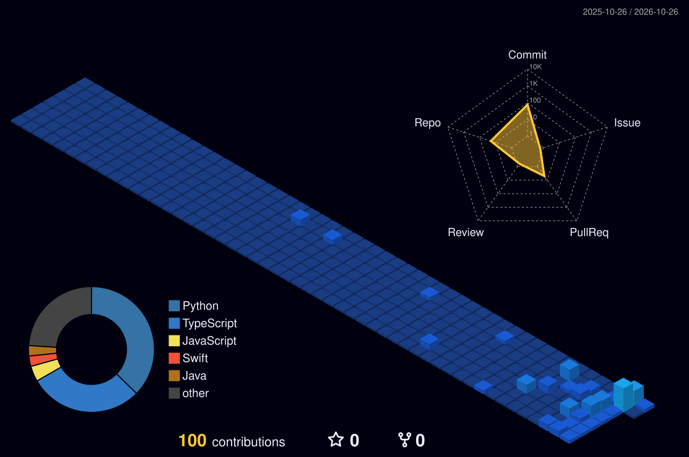

 

### `Design. Develop. Innovate.`

*Building practical digital experiences with software engineering, AI, and connected technology.*

---

## 🧬 About Me

Hello! I'm **Sachintha Dhanasanka**, a **First-Class BSc graduate** with a passion for designing and developing useful, reliable software. I enjoy working across the stack, exploring intelligent applications, and connecting software with the physical world through IoT.

- 🎓 **Education:** BSc — First-Class Honours *(completed)*
- 🧑‍💻 **Focus:** Full-stack software development and application engineering
- 🤖 **Exploring:** Artificial Intelligence, Machine Learning, and intelligent automation
- 🌱 **Research interest:** IoT-enabled precision irrigation and smart agriculture
- 🧰 **Approach:** Clean code, maintainable architecture, testing, and continuous learning
- 🌐 **Portfolio:** [www.sachintha.site](https://www.sachintha.site)
- 📍 **Based in:** Sri Lanka

> I like turning complex ideas into thoughtful, practical applications — from web and mobile experiences to data-driven and IoT-enabled systems.

## ⚡ Technology Universe

### Languages

### Web, Frontend & Backend

### Mobile, Data & IoT

### Developer Tools

## 🚀 Featured Work

| Project | What it explores |
|---|---|
| [🌾 Deep Learning AgriTech](https://github.com/sachintha2001/Deep-Learning-project-in-AgriTech-) | Deep-learning concepts applied to agriculture. |
| [🚘 AutoCare Hub](https://github.com/sachintha2001/AutoCare-Hub) | An application project focused on automotive services. |
| [🎫 E-Ticket](https://github.com/sachintha2001/E-Ticket) | Electronic ticketing application. |
| [🌐 FlowPilot Web](https://github.com/sachintha2001/FlowPilot-Web) | Modern web application project. |
| [💰 FinanceApp](https://github.com/sachintha2001/FinanceApp) | Personal finance application. |
| [☕ Java Blog App](https://github.com/sachintha2001/blog_app_java) | Blog application built with Java. |
| [🏨 Enterprise Hotel System](https://github.com/sachintha2001/Enterprise-hotel-system) | Hotel management system. |
| [📦 Inventory Management](https://github.com/sachintha2001/Inventory-Management-System) | Inventory and stock management application. |
| [📝 Online Examination](https://github.com/sachintha2001/Online-Examination-System) | Online examination system project. |

## 🌱 Research Spotlight — Smart Irrigation

### IoT-Enabled Precision Irrigation Management Using LoRaWAN

A research project exploring how sensor data and connected devices can support more targeted irrigation for agriculture.

- **Sensing:** Soil moisture, temperature/humidity, and rain detection
- **Embedded systems:** ESP32-based field nodes
- **Connectivity:** LoRa / LoRaWAN concepts for field data communication
- **Monitoring:** Cloud-connected data and dashboard concepts
- **Goal:** Support bed-level irrigation decisions and more efficient water use

*Project descriptions are concise summaries; consult the relevant repository and project report for implementation details and validated results.*

## 📈 GitHub Analytics

## 🧊 3D Contribution Graph

This profile is configured to generate a 3D contribution graph automatically. After adding the included GitHub Actions workflow, the image below will appear once the workflow has completed successfully.

## 🤝 Let's Connect

  

*Thanks for stopping by. Explore my repositories, and let's build something useful.*

